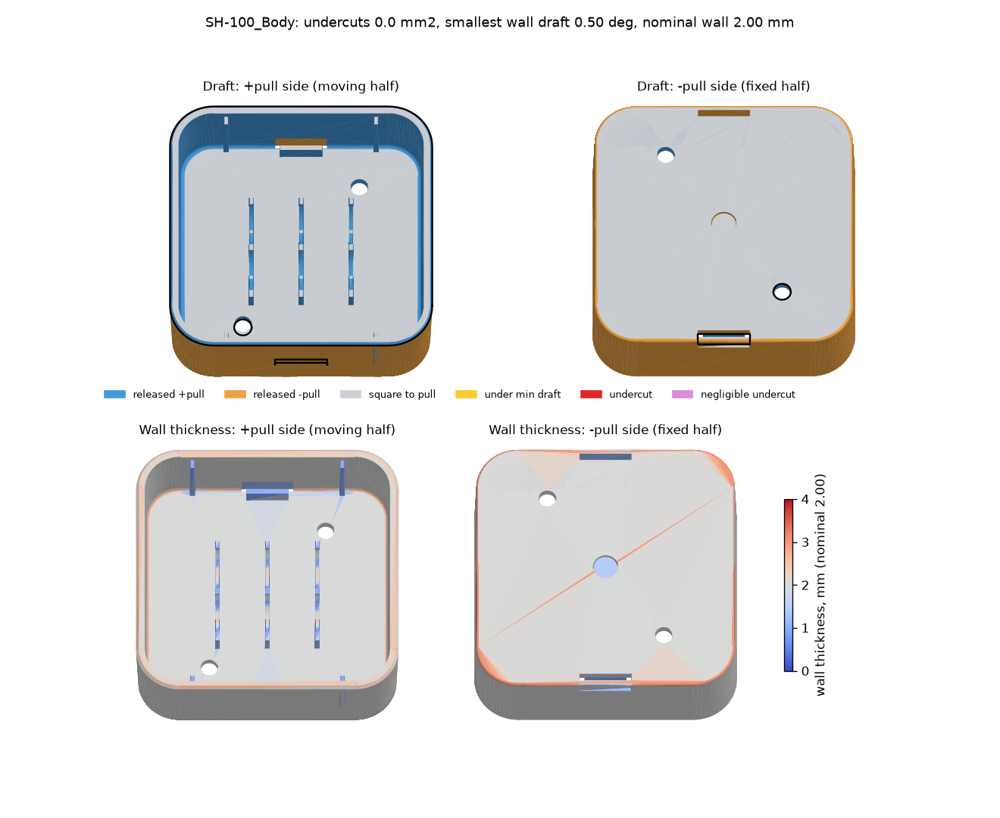
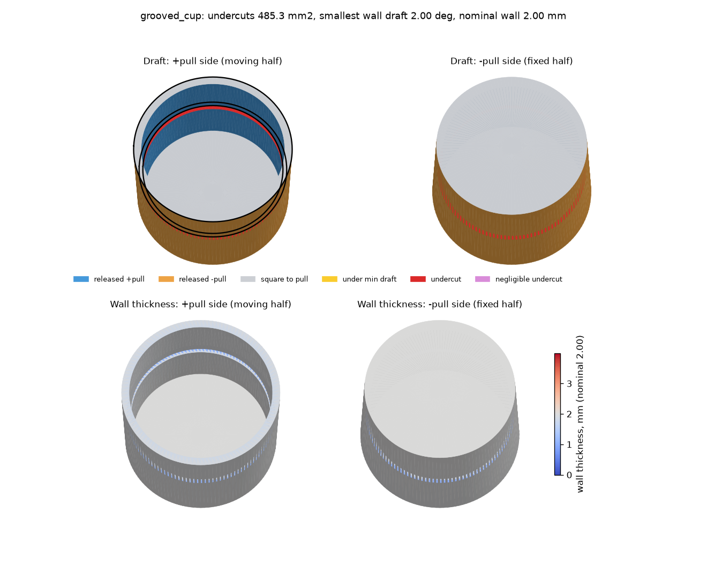

# injection-moulding-analyzer

`mouldcheck` runs a mould maker's first checks on a part. It reads an STL plus the
direction the mould opens, and answers the questions a toolmaker asks before quoting:

- Does every wall have draft, and which half of the tool releases it?
- Where are the undercuts, and how far would steel have to move to clear them?
- Where is the wall too thick (sink, voids) or too thin to fill?
- Where can the parting line go?

Plus a snap-fit cantilever calculator.

```
python -m mouldcheck part.stl --pull 0 0 1 --min-draft 0.5 --out results/
```

Lengths are in the STL's units, and the defaults assume millimetres, as CAD
exports normally are. The run prints a summary and, with `--out`, writes a JSON
report and the figure below.



*The body of a two-part snap-fit housing, as `mouldcheck` sees it. The housing is
my own design, generated by `snap_fit_housing.py` in
[fusion360-parametric-parts](https://github.com/nrobson3/fusion360-parametric-parts)
and exported from Fusion as STL; the STLs themselves are not in this repo. The
top row is draft, coloured by the half that releases each face, with the
parting-line candidate in black. The bottom row is wall thickness against the
2.00 mm nominal.*

## Results on a real part

The housing was designed for a straight-pull, two-plate tool:
- the body's snap catches are formed by pass-through cores;
- the cover's catch faces are formed by cavity steel reaching through notches in the plate edge.

So a correct tool should find no undercut that needs a side action, and draft
matching the design.

| Check | SH-100 body | SH-200 cover |
|---|---|---|
| Smallest wall draft | 0.50° (bosses; walls 1.5°) | 0.50° |
| Area under 0.5° draft | 0 | 0 |
| Undercuts needing a side action | **0** | **0** |
| Negligible undercuts | none | 2 × 2.35 mm², **0.005 mm** deep |
| Nominal wall | 2.00 mm | 2.00 mm |
| Thickest point | 3.00 mm | 2.65 mm |
| Thin areas (< 1.0 mm) | 730 mm²: 99 % the three ribs and four deflection stops (0.45–0.49× the wall, by design); the rest small faces by the snap-catch windows | 16 mm², all on the snap arms by their barbs (the arms are 1.2 mm, 0.6× the wall, by design) |

The cover's two "negligible" regions are real and worth knowing about. Below each
snap barb there is a 0.2 mm strip of arm that continues the arm's 1.5° draft.
Seen straight along the pull, that strip sits under the barb's lead-in ramp by
0.2 × tan 1.5° = 0.005 mm. Forming the strip from the other half removes the
overlap. `mouldcheck` finds it, measures it and calls it negligible.

The 2.65 mm maximum on the cover is the inside corner where the plate meets the
wall. A hand calculation of the circle inscribed in that corner (2.0 mm wall,
R1 inside, R0.5 outside) gives 2.69 mm.

## How each check works

**Draft.** For a face with outward normal n and pull direction d, draft is
asin(n·d). Faces with draft ≥ the minimum are released by the +pull half; faces
with draft ≤ −minimum by the −pull half. Faces square to the pull are shut-offs
and floors. Everything in between is flagged, and grouped into connected
regions with their area and location.

A 0.01° allowance covers faceting. The flat facets of a tapered cylinder sit
slightly under its true taper (by a factor of cos(π/N) for N facets), so a boss
drafted at exactly the minimum would otherwise fail.

**Undercuts.** Each face is released along +pull or −pull by the sign of n·d.
A ray from the face's centroid in that direction must leave the part. If it hits
the part, the steel forming that face cannot pull straight. Blocked faces are
grouped into connected regions.

Each region then gets a **depth**, from the cheaper of two fixes:
- **Side action.** A slide or collapsing core forms the whole region, moves
  sideways, then leaves with one half. So the region is tested as a unit: every
  face is sampled at its centroid and near its three corners. Each sample is
  shifted along its face's sideways normal until a straight path out is clear.
  The search doubles the step from 0.01 mm, then bisects, so an obstacle further
  along the shift does not fool it. Both halves are tried, and the region needs
  its worst sample. A face square to the pull (a groove roof) has no sideways
  normal of its own. It borrows the one of the nearest face that faces it across
  open space, such as the groove's back wall, never a face on the far side of
  the material.
- **Back-draft.** Form the region from the other half instead. The overlap is
  then the region's height along the pull × tan(draft), provided that half's
  path is clear. It needs no moving steel, so it is chosen unless a side action
  is more than 0.01 mm shallower.

A region that neither fix clears within 20 mm is reported without a depth.
Regions shallower than 0.02 mm are reported as negligible and painted
separately. Without a depth, a yes/no undercut check flags tolerance-level
overlaps like the one on the cover as if they needed a slide.

**Wall thickness.** The main measure is a **ray**: the distance along the
inward normal to the far side of the wall. It is exact against an opposite
wall. From an edge face (the rim of a plate, the side of a slot, the small faces
of an edge round) it runs along the wall instead and reads long. Where it reads
over 1.5× the first-pass nominal, two more measures decide:
- **Wall.** The ray reading of the nearest face whose ray is not long, i.e.
  the wall the edge belongs to.
- **Ball.** The diameter of the largest ball inside the material that touches
  the face, found by bisection against the triangles themselves (exact
  point-to-triangle distances). A ball never exceeds the true thickness, so
  where it is bigger than the wall reading the section really is thick: a boss
  or rib root, a thick floor.

An edge face reads the larger of the two, never more than its own ray. The ball
on its own is no good at edges. A ball touching a face near a convex edge is
pinched by that edge: 0.008 mm on the small faces of the cover's edge round.
The first version used a ball sampled every 0.5 mm, and that flagged the cover's
snap arms and boss walls as thin when they are 1.2 mm.

**Parting line.** These are the mesh edges where the release direction flips
from +pull to −pull, chained into loops. Each loop is reported as planar (a flat
shut-off) or stepped, with its length. Faces with no draft belong to neither
half. Where such a land separates the halves, the flip happens across the land,
not at an edge, so no loop is found there. The report gives the zero-draft area
so this cannot pass unseen.

**Snap fits.** A constant-section cantilever with a rigid root:
- strain ε = 1.5 t y / L²;
- tip force P = b t² E ε / (6 L);
- push-on force W = P (μ + tan α) / (1 − μ tan α);
- allowable strain is 70 % of yield for one assembly, and 60 % of that for repeated use.

A lead-in that self-locks at the given friction is refused. These are the
standard straight-cantilever formulas from resin suppliers' snap-fit design
guides (for example Bayer MaterialScience's *Snap-Fit Joints for Plastics*).

```python
from mouldcheck import checks

# ABS arm: 12.1 long, 1.2 thick, 12 wide, 0.6 mm to clear the catch
r = checks.cantilever_snap(L=12.1, t=1.2, b=12.0, y=0.6, E=2200, yield_strain=0.026,
                           lead_deg=30, mu=0.6)
# strain 0.74 % against 1.09 % allowed (safety 1.48); push-on force 7.0 N
```

## Tests

The tests use parts with answers you can work out by hand. `mouldcheck.shapes`
builds open cups by revolving a profile: drafted walls, an optional internal
groove, any floor thickness.



*A cup with a 1.2 mm internal groove. The groove's roof, floor and back wall
are found as one undercut region, 1.200 mm deep. The steel at the top of the
back wall has to move the full groove depth to pass the lip above it; the
walls' draft only helps lower down. The 0.8 mm wall behind the groove is
flagged thin.*

```
python -m unittest discover tests
```

The tests check:
- draft read back to 0.01° at four angles;
- the release side of every wall;
- groove undercut depths of 0.5, 1 and 1.5 mm, to 0.005 mm;
- the same depth with the part and pull rotated together;
- a tall groove, an external ring groove and an inward lip;
- zero undercuts on a plain cup, and a 0.01 mm groove called negligible;
- the same answer with the pull reversed;
- no depth when nothing clears the undercut within reach;
- a face wound against its neighbours is caught;
- nominal wall, a thick floor, a thin groove wall, and thin plates whose
  edges must not read thick;
- an open mesh reported rather than crashing;
- the parting-line loop's length and height;
- the snap-fit numbers against a hand calculation, and bad inputs refused.

## Requirements and limits

- Python 3.9 or newer, with numpy and matplotlib.
- Ray tests are vectorised brute force. A full run, figure included, takes about
  3 s for the 2,000-triangle test cup or the 4,500-triangle cover, and 5 s for
  the 6,100-triangle body, on a laptop. Time grows faster than the triangle
  count, so export the STL at a moderate refinement.
- Undercut detection fires one ray per face. A large face that is only partly
  overhung can be missed, so faces should be small next to the features that
  could trap them.
- The part must be a closed, consistently wound mesh. The report says if it
  isn't.
- One straight pull per run. To check a side action, run again with its
  direction.
- Faceting reads curved walls slightly thin and tapers slightly under their
  draft, by a factor of cos(π/N) for N facets per circle. On a coarse mesh, a
  wall at exactly half the nominal can be flagged thin, and a draft at exactly
  the minimum can be flagged low. Export at 64 or more facets per circle.
- An edge face takes the reading of the nearest wall. Where a thin wall meets a
  thick one, the edge faces at the junction can take either.
- Flow and weld-line prediction need a fill simulation and are out of scope.

## License

MIT. See [LICENSE](LICENSE). Copyright (c) 2026 Navy Robson.
